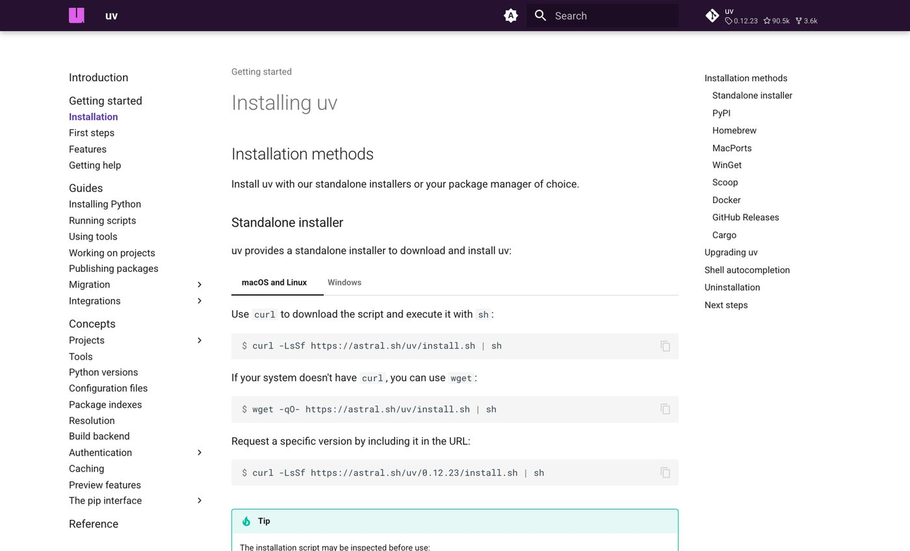
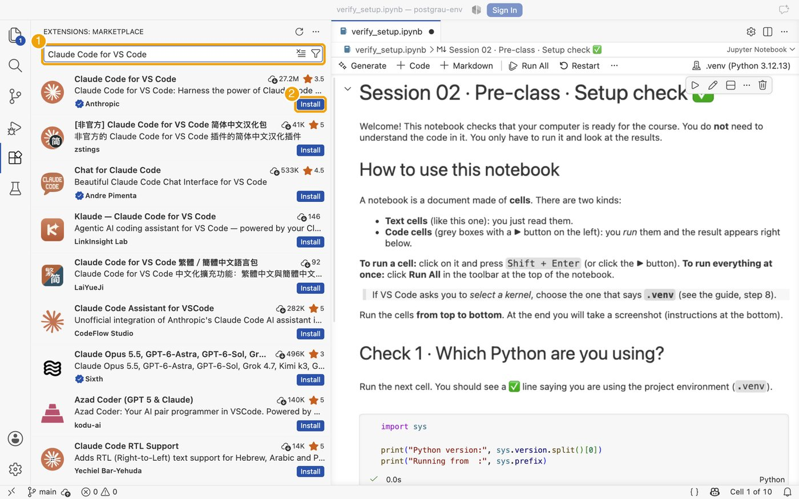
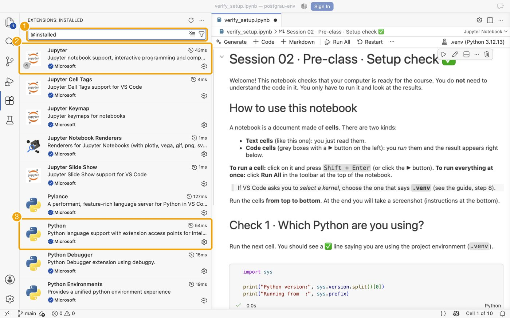

# Part 2 · Installation

[← Back to the guide](README.md) · Previous: [1 · Accounts](01_accounts.md) · Next: [3 · Verification](03_verification.md)

You will install five things. Take them in order; each one ends with a check.

## 2.0 Open a terminal
A terminal is a window where you type commands and press **Enter**.

| Your system | How to open it |
|---|---|
| **Windows** | Press the Windows key, type **PowerShell**, open *Windows PowerShell*. |
| **macOS** | Press `Cmd + Space`, type **Terminal**, press Enter. |
| **Linux** | Press `Ctrl + Alt + T` (or search for *Terminal*). |

In this guide, a grey box is something you type (or paste) in the terminal, followed by **Enter**.

## 2.1 Visual Studio Code
1. Download VS Code for your system from <https://code.visualstudio.com/download>.
2. Install it with the default options.
   * **Windows:** run the installer. Keep *"Add to PATH"* ticked.
   * **macOS:** open the downloaded file and drag *Visual Studio Code* to the **Applications** folder.
   * **Linux:** install the `.deb` / `.rpm` package from the same page.
3. Open VS Code once to check that it starts.


*The download page picks your system automatically (Windows / macOS / Linux).*

Official help: [VS Code setup overview](https://code.visualstudio.com/docs/setup/setup-overview).

## 2.2 `uv`
Copy the command for your system into the terminal and press Enter.

**macOS and Linux**
```bash
curl -LsSf https://astral.sh/uv/install.sh | sh
```

**Windows (PowerShell)**
```powershell
powershell -ExecutionPolicy ByPass -c "irm https://astral.sh/uv/install.ps1 | iex"
```

Then **close the terminal and open a new one** (important) and check it works:
```bash
uv --version
```
You should see something like `uv 0.9.x` (the number may differ). If you see *"command not found"* or *"not recognized"*, see [Troubleshooting](troubleshooting.md).


*The official page lists the same commands, with tabs for macOS/Linux and Windows. Other ways to install (Homebrew, WinGet…): [uv installation guide](https://docs.astral.sh/uv/getting-started/installation/).*

## 2.3 Git
**Git** keeps the history of your work.

| System | What to do |
|---|---|
| **Windows** | Download *Git for Windows* from <https://git-scm.com/downloads/win> and install it with the **default options**. (It includes *Git Credential Manager*, which signs you in through your browser.) |
| **macOS** | Open the Terminal and run `git --version`. If Git is not installed, macOS offers to install the *Command Line Tools*: accept. Alternative: <https://git-scm.com/downloads/mac>. |
| **Linux** | Debian/Ubuntu: `sudo apt install git`. Fedora: `sudo dnf install git`. Other systems: <https://git-scm.com/downloads/linux>. |

In a **new** terminal, check it and tell Git who you are (once per computer; use the e-mail of your GitHub account):
```bash
git --version
git config --global user.name "Your Name"
git config --global user.email "you@example.com"
```
Without the last two lines, your first commit in VS Code fails with *"Make sure you configure your user.name and user.email in git"*.

## 2.4 GitHub Desktop (recommended on Windows and macOS)
A friendly app to work with GitHub without commands.

1. Download it from <https://desktop.github.com/download/> and install it.
2. Open it and choose **Sign in to GitHub.com**. Your **web browser** opens: sign in and click **Authorize**. You do not type or store any password or token in the app.
3. Official help: [Getting started with GitHub Desktop](https://docs.github.com/en/desktop/overview/getting-started-with-github-desktop).


*Download page of GitHub Desktop.*

> **Linux:** GitHub Desktop has no official Linux version. Use the **Source Control** panel of VS Code instead ([docs](https://code.visualstudio.com/docs/sourcecontrol/overview)); when you clone or push for the first time, VS Code opens the browser to authorize your GitHub account.

> **More advanced authentication (optional, not needed in this course).** You can later use an **SSH key** ([docs](https://docs.github.com/en/authentication/connecting-to-github-with-ssh)) or a **personal access token** ([docs](https://docs.github.com/en/authentication/keeping-your-account-and-data-secure/managing-your-personal-access-tokens)). More on how Git remembers credentials: [Caching your GitHub credentials in Git](https://docs.github.com/en/get-started/git-basics/caching-your-github-credentials-in-git) · [Git Credential Manager](https://github.com/git-ecosystem/git-credential-manager).

## 2.5 VS Code extensions
1. Open VS Code. Click the **Extensions** icon in the left bar (four squares) or press `Ctrl + Shift + X` (`Cmd + Shift + X` on macOS).
2. Search for each of these and click **Install**:

| Search for | Publisher | What it is for | Link |
|---|---|---|---|
| **Python** | Microsoft | Python support | [Marketplace](https://marketplace.visualstudio.com/items?itemName=ms-python.python) |
| **Jupyter** | Microsoft | Open and run notebooks | [Marketplace](https://marketplace.visualstudio.com/items?itemName=ms-toolsai.jupyter) |
| **GitHub Copilot** | GitHub | AI assistant (autocomplete and chat) | [Marketplace](https://marketplace.visualstudio.com/items?itemName=GitHub.copilot) · [VS Code docs](https://code.visualstudio.com/docs/copilot/overview) |
| **Claude Code for VS Code** | Anthropic | Second AI assistant | [Marketplace](https://marketplace.visualstudio.com/items?itemName=anthropic.claude-code) · [Docs](https://code.claude.com/docs/en/vs-code) |

*Claude Code:* install it only; credentials come later (see [1.4](01_accounts.md#14-claude-later)).


*Extensions icon, search box, **Install** button. The exact list of results may differ a little.*


*Choose *Claude Code for VS Code* published by **Anthropic**.*


*Check: `@installed` in the search box lists what you have. Jupyter (2) and Python (3) must be there.*

### Sign in to GitHub from VS Code
Click the **Accounts** icon (person icon, bottom of the left bar), or *Sign In* at the top. This window appears. Choose **Continue with GitHub**: your browser opens, click **Authorize Visual Studio Code**, then **Open Visual Studio Code** when the browser asks. Use the GitHub account with the student benefit. You never type a password in VS Code. (The same sign-in is used later to push to GitHub.)


*Choose *Continue with GitHub* (not a password).*

More: [Jupyter Notebooks in VS Code](https://code.visualstudio.com/docs/datascience/jupyter-notebooks).

---
[← Back to the guide](README.md) · Previous: [1 · Accounts](01_accounts.md) · Next: [3 · Verification](03_verification.md)
