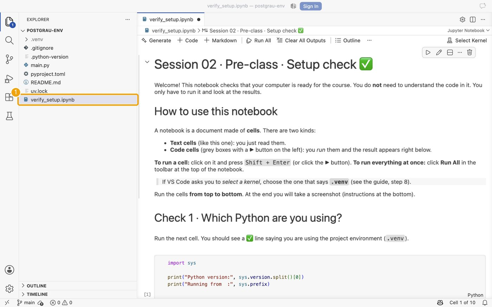
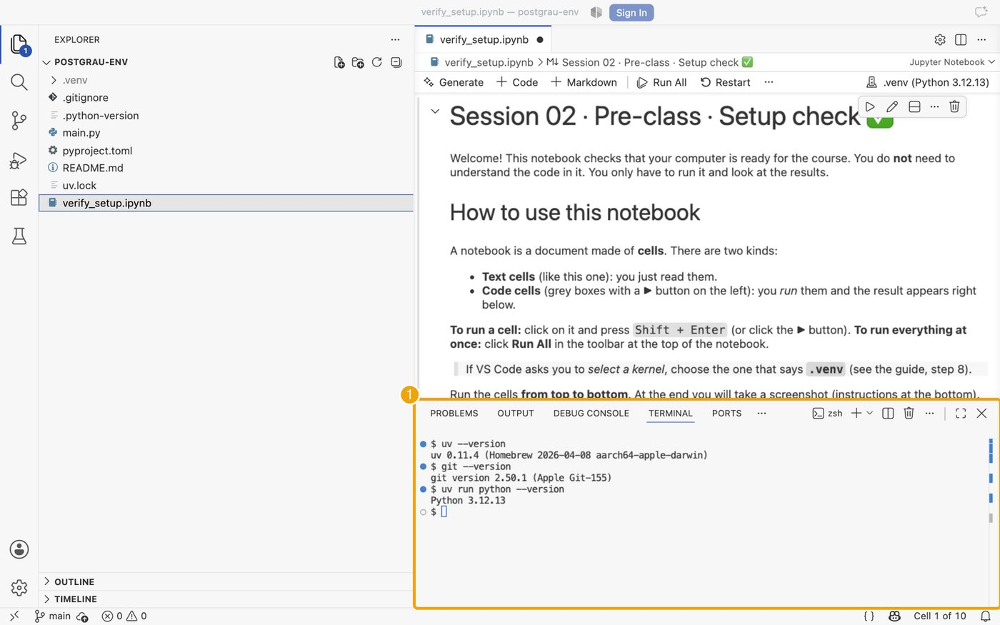
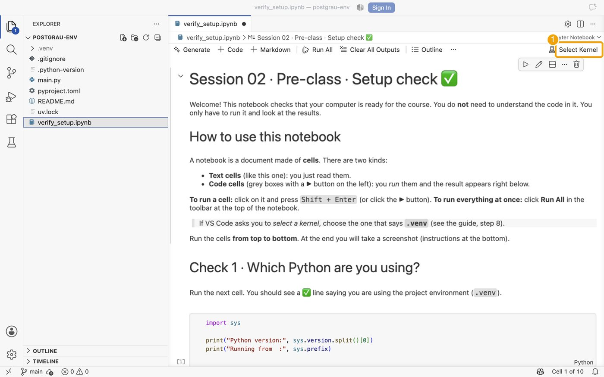
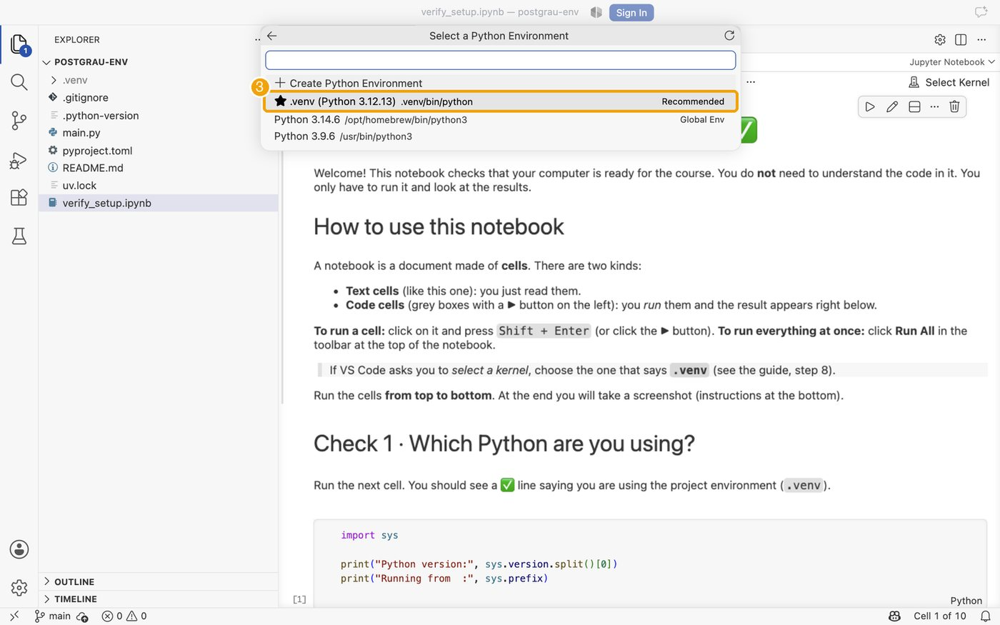
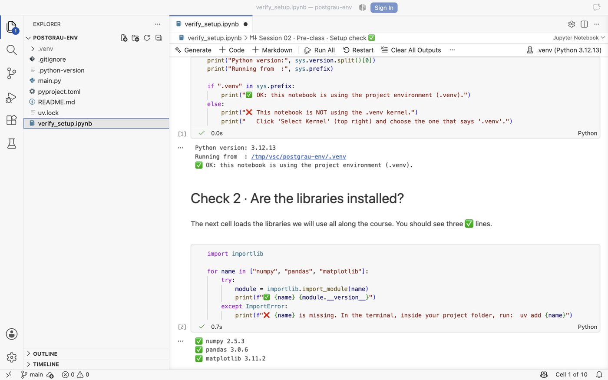
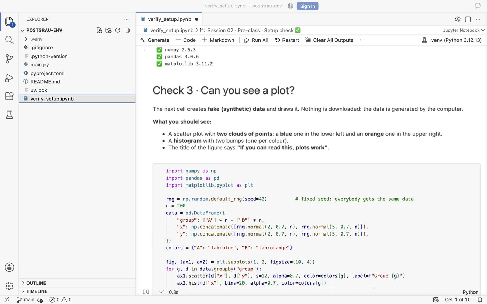

# Part 3 · Verification (the required exercise)

[← Back to the guide](README.md) · Previous: [2 · Installation](02_installation.md) · Optional next: [4 · Your first repository](04_git_exercise.md)

You will create your project, open a **check notebook** and see that everything works. The result is your ticket for the *traffic light* at the start of the class.

## 3.1 Create your project
We create a project called `postgrau-env`. Open a terminal and run these four commands one by one.

```bash
uv init --python 3.12 postgrau-env
cd postgrau-env
uv add pandas matplotlib
uv add --dev ipykernel
```

| Command | Meaning |
|---|---|
| `uv init --python 3.12 postgrau-env` | Creates a new project folder called `postgrau-env` that uses Python 3.12 (downloaded automatically if you do not have it). |
| `cd postgrau-env` | "Go into" that folder. |
| `uv add pandas matplotlib` | Adds the libraries to the project (data tables and plots). |
| `uv add --dev ipykernel` | Adds the piece that lets notebooks run inside VS Code. |

What was created inside the folder:
```
postgrau-env/
├── .venv/            ← the private environment (do not touch it)
├── .python-version   ← which Python
├── pyproject.toml    ← the list of libraries your project needs
├── uv.lock           ← the exact versions installed (do not edit it)
├── main.py
└── README.md
```

> **The two commands you will use all the time**
> * `uv add <library>` → *"I need this library in my project."* Example: `uv add seaborn`
> * `uv remove <library>` → *"I no longer need it."*
>
> Always run them **inside the project folder**. More commands in the [cheat sheet](cheatsheet.md).

## 3.2 Get the check notebook
1. Open the course repository <https://github.com/DataScienceUB/posgradoDSAI2026> in your browser (signed in to GitHub).
2. Go to `Session_02/pre_class/` and click **`verify_setup.ipynb`**.
3. Click **Download raw file** (the icon with a down arrow, top right of the file view).
4. Move the downloaded file **into your `postgrau-env` folder**.

## 3.3 Open the project in VS Code
Menu **File → Open Folder…** (on macOS: *File → Open…*), select the `postgrau-env` folder and click *Yes, I trust the authors* if asked. On the left you should see your files, including `verify_setup.ipynb`.


*The project folder open in VS Code: your files appear in the Explorer (1).*

**Tip:** you can also open a terminal inside VS Code (*Terminal → New Terminal*). It starts in your project folder:


*The terminal panel (1). Here `uv --version`, `git --version` and `uv run python --version` all answer: everything is installed.*

## 3.4 Choose the kernel
The **kernel** is the Python that runs the notebook. It must be the one of your project, called **`.venv`**.


*(1) Open `verify_setup.ipynb` and click **Select Kernel** at the top right.*


*(2) Choose **Python Environments…***


*(3) Pick the entry that says **.venv** (marked *Recommended*, Python 3.12).*


*(4) The top right now says **.venv (Python 3.12.x)**. Click **Run All**.*

*Not listed?* Check that you opened the **folder** (not only the file), then press `Ctrl/Cmd + Shift + P`, type *Reload Window* and try again. Still not working? Use the **Plan B** in [Troubleshooting](troubleshooting.md#plan-b-jupyterlab-in-your-browser).

## 3.5 Run it and read the results
Click **Run All** in the notebook toolbar. All the checks must show ✅, and you must see a plot with a blue and an orange cloud of points.


*Check 1 and Check 2: all lines with ✅.*


*Check 3: the plot with a blue and an orange cloud, and a histogram with two bumps.*

## 3.6 Take the screenshot
Take a screenshot of the notebook showing the ✅ lines and the plot (you may need to scroll). **Bring it to the class** (on your phone or laptop):
* ✅ everything green → you are ready.
* ❌ something red → no problem, we will fix it together in the first minutes of the class.

**That is the required exercise.** If you can create the project and run the notebook, you are ready for Session 02.

---
[← Back to the guide](README.md) · Previous: [2 · Installation](02_installation.md) · Optional next: [4 · Your first repository](04_git_exercise.md)
