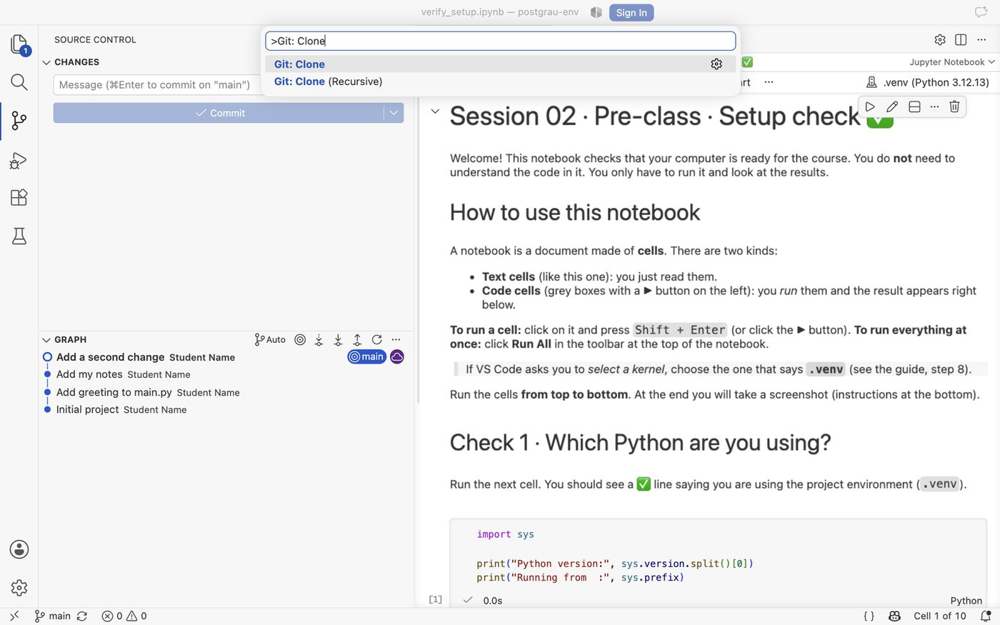
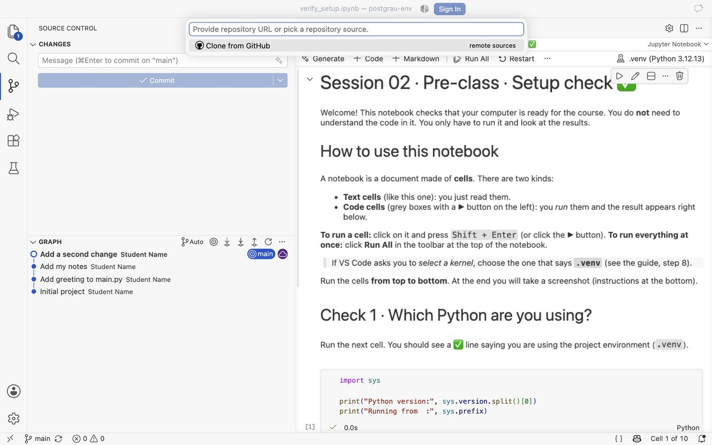
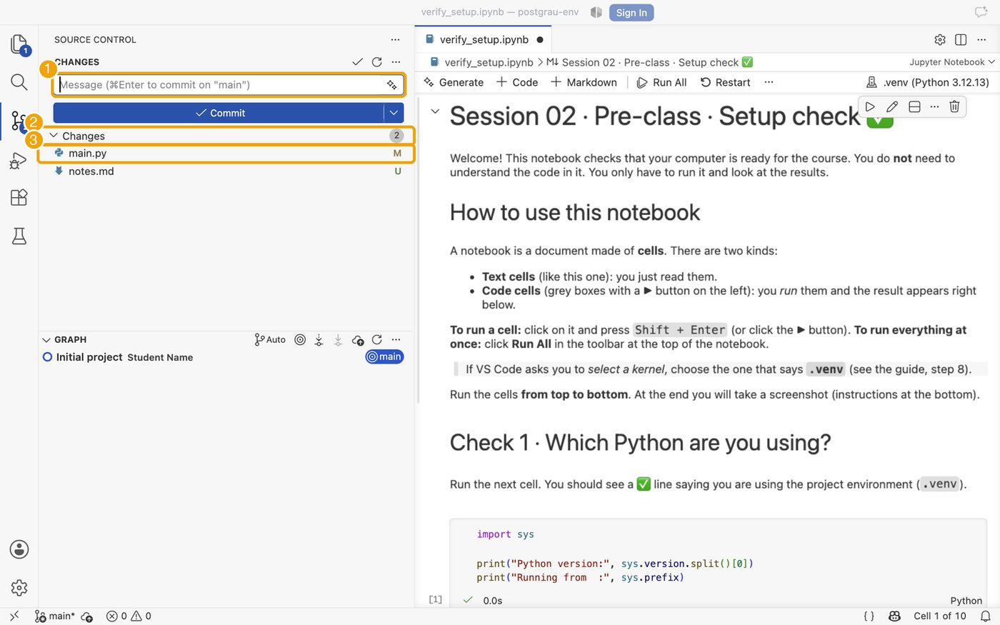
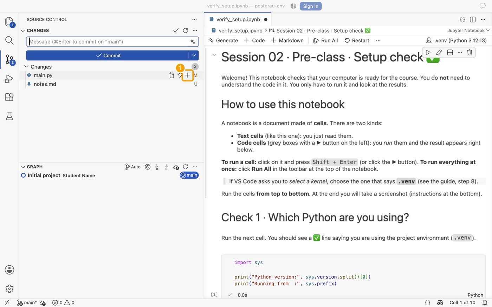
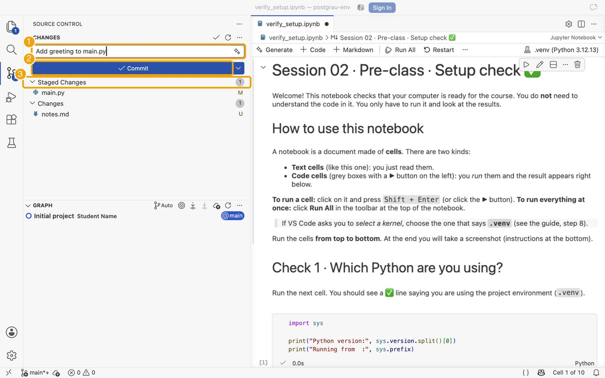
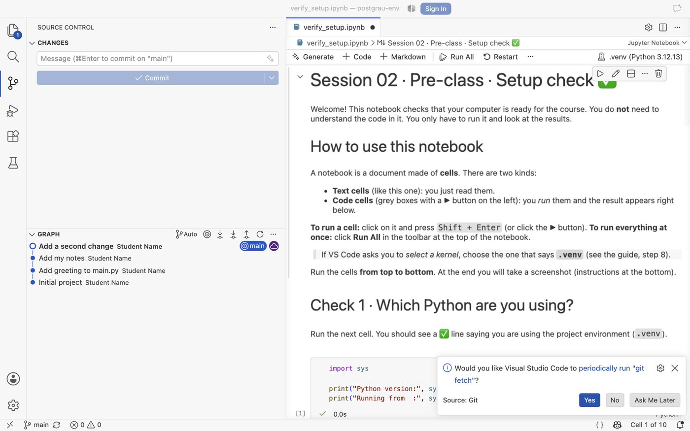

# Part 4 · Optional: your first repository

[← Back to the guide](README.md) · Previous: [3 · Verification](03_verification.md)

**Optional**, about 10 minutes. It only checks that your **GitHub credentials are correctly set on your laptop**, so we do not lose time in class. You will create a repository on GitHub, clone it to your laptop, change a file and send the change back.

> If something asks for a password or a token and you do not know what to give: **stop**, take a screenshot and bring it to the class. Do not create tokens or SSH keys for this exercise.

## With GitHub Desktop (Windows / macOS)
1. **File → New repository…** Name: `hello-postgrau`. Tick *Initialize this repository with a README*. Click **Create repository**.
2. Click **Publish repository** (top bar). Keep it **private**. Authorize in the browser if asked.
3. Open your repository on <https://github.com> and check that it is there.
4. Delete the local copy and **clone it again**: *File → Clone repository…* → tab *GitHub.com* → `hello-postgrau` → *Clone*.
5. Open the folder (*Repository → Open in Visual Studio Code*), edit `README.md` (write one line). In GitHub Desktop write a summary ("My first change"), click **Commit to main** and then **Push origin**.
6. Refresh the repository page on github.com: you should see your change. ✅

Official help: [Cloning a repository in GitHub Desktop](https://docs.github.com/en/desktop/adding-and-cloning-repositories/cloning-a-repository-from-github-to-github-desktop) · [Hello World with GitHub](https://docs.github.com/en/get-started/start-your-journey/hello-world).

## With VS Code (Linux, or if you prefer it)
1. On <https://github.com/new> create a **private** repository `hello-postgrau` with *Add a README file* ticked.
2. In VS Code: `Ctrl/Cmd + Shift + P` → **Git: Clone** → paste the repository URL → choose a folder. Authorize in the browser if asked.

*`Ctrl/Cmd + Shift + P`, type *Git: Clone* and press Enter.*

*Choose **Clone from GitHub** and then your repository.*

3. Edit `README.md` and save it. Open the **Source Control** panel (third icon in the left bar, or `Ctrl + Shift + G`).

*(1) message box, (2) *Changes* list: **M** = modified, **U** = new file.*

4. **Stage** the file: hover over it and click **+** (this chooses it for the next commit).

*Hover a file and click **+**.*

5. Write a **message** that says what you did, check the file is under *Staged Changes* and click **Commit** (a save point on your laptop).

*Message (1), **Commit** (2), *Staged Changes* (3).*

> **If VS Code says “There are no staged changes to commit…”**, it offers to commit everything: click **Yes**.
>
> 
> *Never / Always / Cancel / **Yes**. *Yes* is fine for now.*

6. A commit is only on your laptop. Click **Sync Changes** to send it to GitHub.

*The button reads **Sync Changes 1↑**: one commit is **not on GitHub yet** (the status bar says the same).*

*The first time, VS Code asks for confirmation. Click **OK**.*

*Done: the arrows are gone. Your commits are on GitHub.*

7. Check on github.com that your change is there. ✅

**Remember:** *no push, no safe*. Until the arrow disappears, your work exists only on your laptop.

More: [VS Code source control](https://code.visualstudio.com/docs/sourcecontrol/overview).

---
[← Back to the guide](README.md) · Previous: [3 · Verification](03_verification.md)
