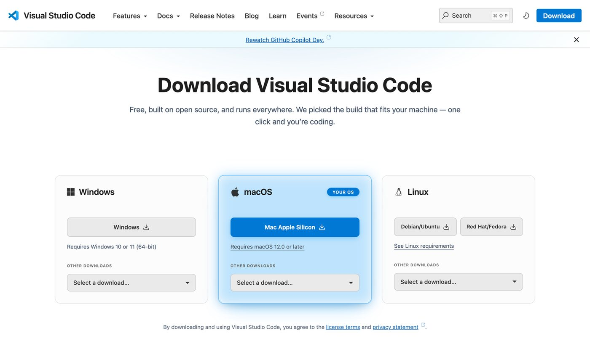
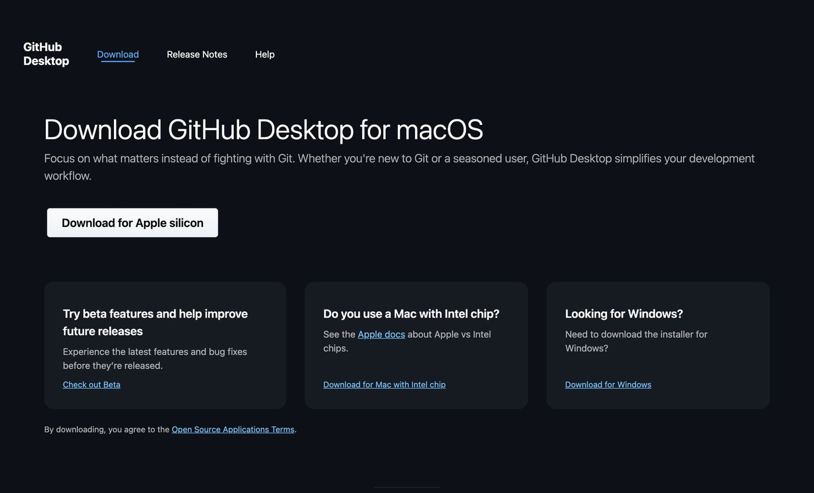
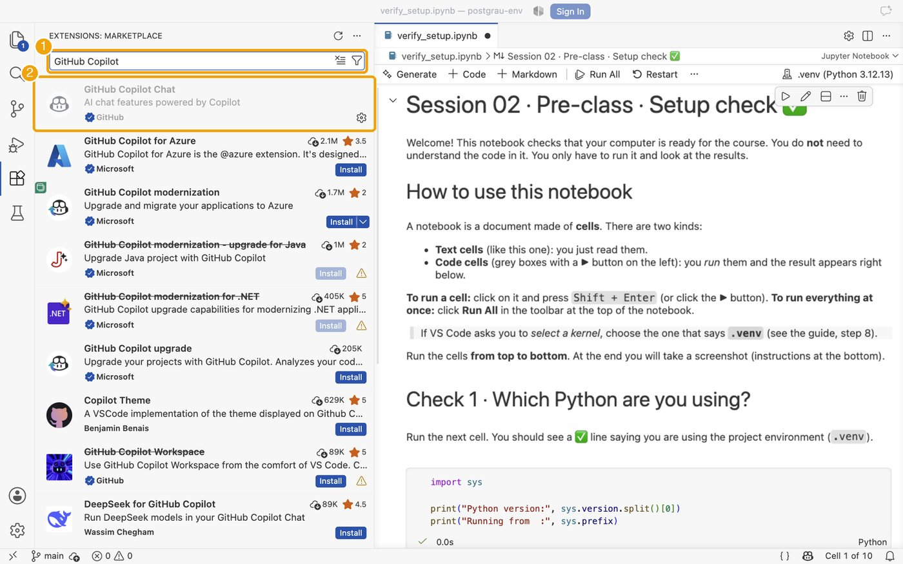
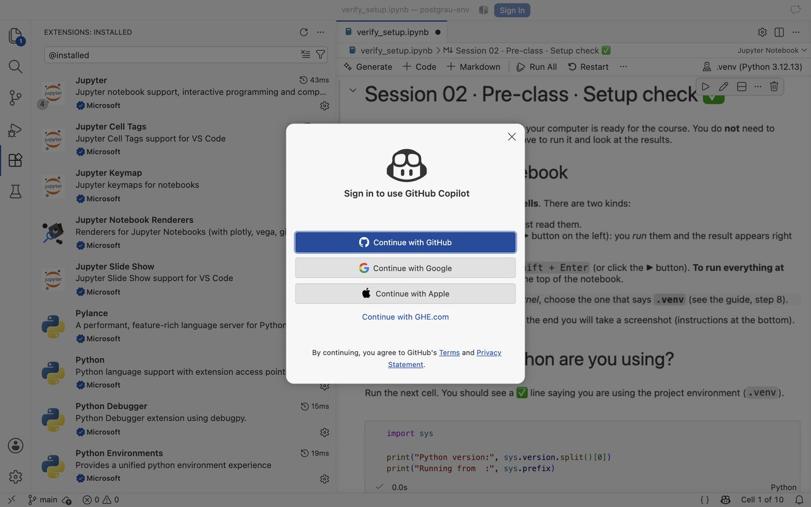
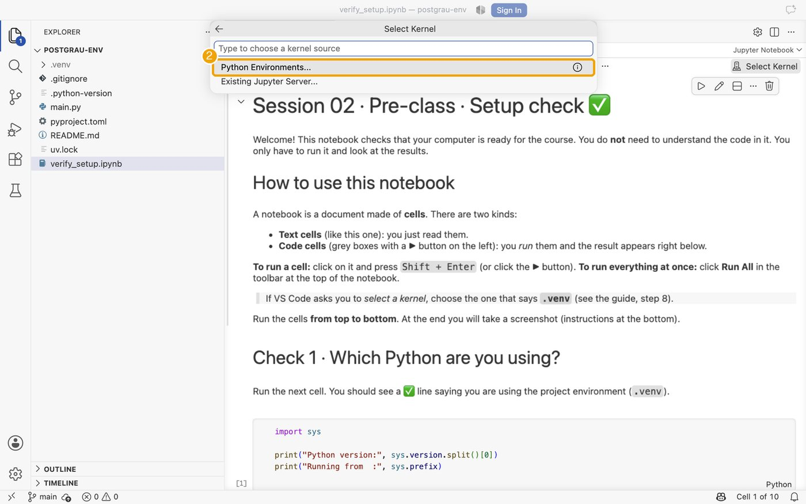
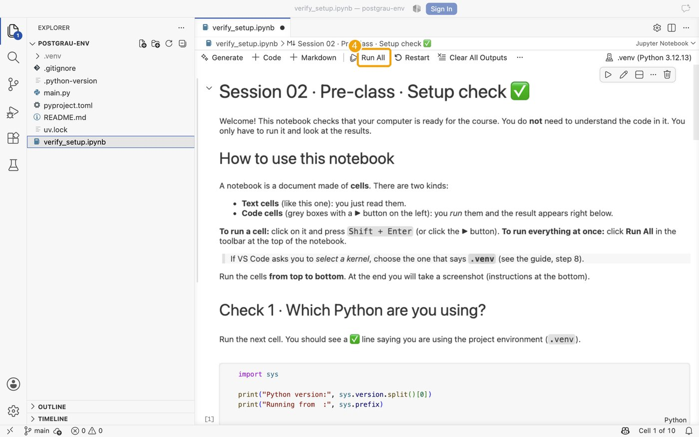
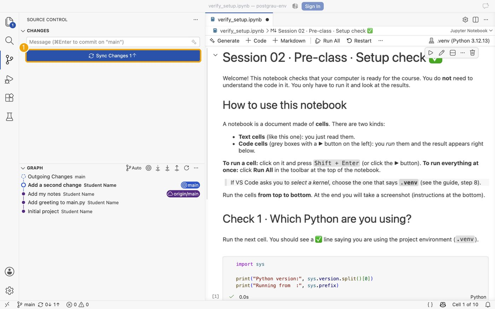
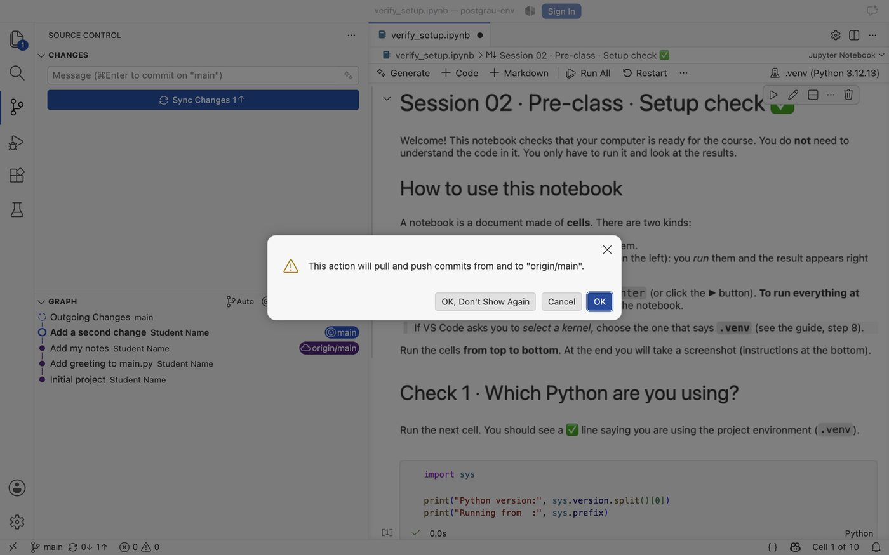
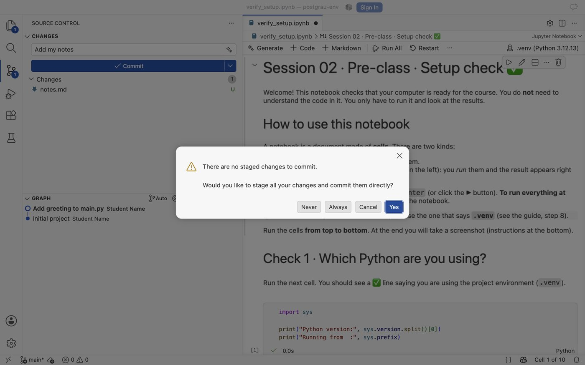
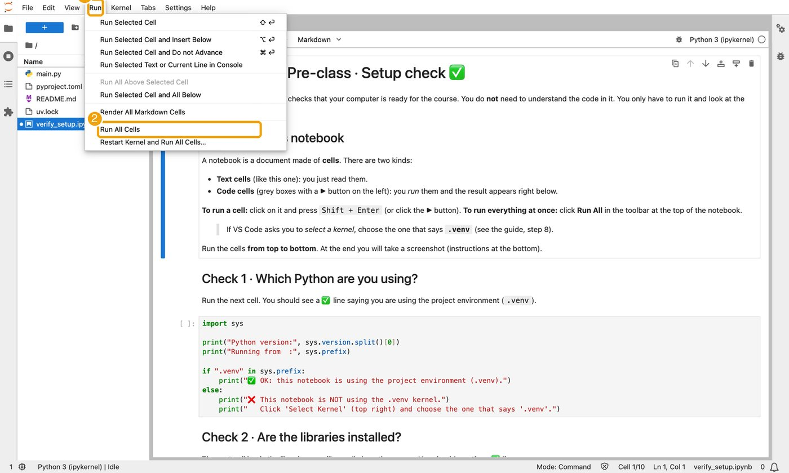

# Session 02 · Pre-class guide: prepare your computer

**Do this on your own, before Session 02.** It takes about 40–50 minutes.
You do not need any programming experience: follow the steps in order and copy the commands exactly.

**At the end you will have:**
1. Visual Studio Code (VS Code), the program we will work in.
2. `uv`, a tool that creates a clean, reproducible Python environment for each project.
3. Git and a GitHub account, to keep the history of your work and to get the course resources.
4. A project folder with the libraries we need, and a notebook (`verify_setup.ipynb`) where every check shows ✅.
5. The AI assistants (GitHub Copilot and Claude Code) installed in VS Code. You will learn to use them in class.

> **Why `uv`?** A *project* is a folder. `uv` records inside that folder which Python and which libraries it needs, so the project works the same on your laptop, on your classmate's laptop and next year. You do **not** need to install Python separately: `uv` does it for you. ([uv documentation](https://docs.astral.sh/uv/))

Course repository: <https://github.com/DataScienceUB/posgradoDSAI2026> (you need to be signed in to GitHub, and the instructor must have given you access).

---

## Step 0 · Open a terminal
A terminal is a window where you type commands and press **Enter**.

| Your system | How to open it |
|---|---|
| **Windows** | Press the Windows key, type **PowerShell**, open *Windows PowerShell*. |
| **macOS** | Press `Cmd + Space`, type **Terminal**, press Enter. |
| **Linux** | Press `Ctrl + Alt + T` (or search for *Terminal*). |

In the steps below, a grey box is something you type (or paste) in the terminal, followed by **Enter**.

---

## Step 1 · Install Visual Studio Code
1. Download VS Code for your system from <https://code.visualstudio.com/download>.
2. Install it with the default options.
   * **Windows:** run the installer. Keep *"Add to PATH"* ticked.
   * **macOS:** open the downloaded file and drag *Visual Studio Code* to the **Applications** folder.
   * **Linux:** install the `.deb` / `.rpm` package from the same page.
3. Open VS Code once to check that it starts.


*The download page picks your system automatically (Windows / macOS / Linux).*

Official setup help: [VS Code setup overview](https://code.visualstudio.com/docs/setup/setup-overview).

## Step 2 · Install `uv`
Copy the command for your system into the terminal and press Enter.

**macOS and Linux**
```bash
curl -LsSf https://astral.sh/uv/install.sh | sh
```

**Windows (PowerShell)**
```powershell
powershell -ExecutionPolicy ByPass -c "irm https://astral.sh/uv/install.ps1 | iex"
```

Then **close the terminal and open a new one** (this is important) and check that it works:
```bash
uv --version
```
You should see something like `uv 0.9.x` (the number may differ). If you see *"command not found"* or *"not recognized"*, see [Troubleshooting](#troubleshooting).

Other ways to install it (Homebrew, WinGet…): [uv installation guide](https://docs.astral.sh/uv/getting-started/installation/).


*The official page lists the same commands, with tabs for macOS/Linux and Windows.*

## Step 3 · GitHub account, Git and GitHub Desktop
**Git** keeps the history of your work. **GitHub** is the website where repositories (project folders with history) are stored, and where the course resources are. **GitHub Desktop** is a friendly app to work with both, without commands.

### 3a. Create your GitHub account (skip if you already have one)
1. Go to <https://github.com/signup> and create an account ([official guide](https://docs.github.com/en/get-started/start-your-journey/creating-an-account-on-github)). Add your UB e-mail address to the account if you can.
2. **Students: get GitHub Copilot for free.** Request student verification at <https://education.github.com/students> and, once verified, activate *Copilot Student* ([official instructions](https://docs.github.com/en/copilot/how-tos/manage-your-account/getting-free-access-to-copilot-pro-as-a-student-teacher-or-maintainer)). GitHub may ask for proof of enrolment, and verification can take a few days: **start this early**. If it is not ready for the class, do not worry, you can still follow the session.

### 3b. Install Git
| System | What to do |
|---|---|
| **Windows** | Download *Git for Windows* from <https://git-scm.com/downloads/win> and install it with the **default options**. (It includes *Git Credential Manager*, which will sign you in through your browser.) |
| **macOS** | Open the Terminal and run `git --version`. If Git is not installed, macOS offers to install the *Command Line Tools*: accept. Alternative: <https://git-scm.com/downloads/mac>. |
| **Linux** | Debian/Ubuntu: `sudo apt install git`. Fedora: `sudo dnf install git`. Other systems: <https://git-scm.com/downloads/linux>. |

Check it in a **new** terminal, then tell Git who you are (once per computer, use the e-mail of your GitHub account):
```bash
git --version
git config --global user.name "Your Name"
git config --global user.email "you@example.com"
```
Without these two lines, your first commit in VS Code fails with *"Make sure you configure your user.name and user.email in git"*.

### 3c. Install GitHub Desktop (recommended on Windows and macOS)
1. Download it from <https://desktop.github.com/download/> and install it.
2. Open it and choose **Sign in to GitHub.com**. Your **web browser** opens: sign in there and click **Authorize**. This is the recommended way: you do not need to type or store any password or token in the app.
3. Official help: [Getting started with GitHub Desktop](https://docs.github.com/en/desktop/overview/getting-started-with-github-desktop).


*Download page of GitHub Desktop.*

> **Linux:** GitHub Desktop has no official Linux version. Use Git with the **Source Control** panel of VS Code (the third icon in its left bar): [VS Code source control](https://code.visualstudio.com/docs/sourcecontrol/overview). When you clone or push for the first time, VS Code opens the browser to authorize your GitHub account.

> **More advanced ways to authenticate (optional, not needed in this course).** If you later want to work without the browser sign-in you can use an **SSH key** ([docs](https://docs.github.com/en/authentication/connecting-to-github-with-ssh)) or a **personal access token** ([docs](https://docs.github.com/en/authentication/keeping-your-account-and-data-secure/managing-your-personal-access-tokens)). More on how Git remembers your credentials: [Caching your GitHub credentials in Git](https://docs.github.com/en/get-started/git-basics/caching-your-github-credentials-in-git) and [Git Credential Manager](https://github.com/git-ecosystem/git-credential-manager).

## Step 4 · Create your project
We create a project called `postgrau-env`. Run the next four commands one by one.

```bash
uv init --python 3.12 postgrau-env
cd postgrau-env
uv add pandas matplotlib
uv add --dev ipykernel
```

| Command | Meaning |
|---|---|
| `uv init --python 3.12 postgrau-env` | Creates a new project folder called `postgrau-env` that uses Python 3.12 (downloaded automatically if you do not have it). |
| `cd postgrau-env` | "Go into" that folder. |
| `uv add pandas matplotlib` | Adds the libraries to the project (data tables and plots). |
| `uv add --dev ipykernel` | Adds the piece that lets notebooks run inside VS Code. |

What was created inside the folder:
```
postgrau-env/
├── .venv/            ← the private environment (do not touch it)
├── .python-version   ← which Python
├── pyproject.toml    ← the list of libraries your project needs
├── uv.lock           ← the exact versions installed (do not edit it)
├── main.py
└── README.md
```

> **The two commands you will use all the time**
> * `uv add <library>` → *"I need this library in my project."* Example: `uv add seaborn`
> * `uv remove <library>` → *"I no longer need it."*
>
> Always run them **inside the project folder** (the terminal path should end in `postgrau-env`).

**Tip:** you can also open a terminal inside VS Code (menu *Terminal → New Terminal*). It starts in your project folder:


*The terminal panel in VS Code (1). Here `uv --version`, `git --version` and `uv run python --version` all answer: everything is installed.*

> **Why Python 3.12?** In this course we all use **Python 3.12**: it is stable, supported by all the libraries we need and by `uv`, and it makes our environments identical. See which Python versions exist and their support status in the [official Python versions table](https://devguide.python.org/versions/). If at some point you need another version for a project, it is easy to change: run `uv python pin 3.13` inside the project (this edits `.python-version`) and then `uv sync`. Details: [uv: Python versions](https://docs.astral.sh/uv/concepts/python-versions/). For this course, keep 3.12.

## Step 5 · Get the verification notebook
1. Open the course repository <https://github.com/DataScienceUB/posgradoDSAI2026> in your browser (signed in to GitHub).
2. Go to the folder `Session_02/pre_class/` and click **`verify_setup.ipynb`**.
3. Click the **Download raw file** button (icon with a down arrow, top right of the file view).
4. Move the downloaded file **into your `postgrau-env` folder**.

## Step 6 · Open the project in VS Code
1. Open VS Code.
2. Menu **File → Open Folder…** (on macOS: *File → Open…*) and select the `postgrau-env` folder. Click *Yes, I trust the authors* if asked.
3. On the left you should see your files, including `verify_setup.ipynb`.


*The project folder open in VS Code: your files appear in the Explorer (1).*

## Step 7 · Install the VS Code extensions
1. Click the **Extensions** icon in the left bar (four squares) or press `Ctrl + Shift + X` (`Cmd + Shift + X` on macOS).
2. Search for each of these and click **Install**:

| Search for | Publisher | What it is for | Link |
|---|---|---|---|
| **Python** | Microsoft | Python support | [Marketplace](https://marketplace.visualstudio.com/items?itemName=ms-python.python) |
| **Jupyter** | Microsoft | Open and run notebooks | [Marketplace](https://marketplace.visualstudio.com/items?itemName=ms-toolsai.jupyter) |
| **GitHub Copilot** | GitHub | AI assistant (autocomplete and chat) | [Marketplace](https://marketplace.visualstudio.com/items?itemName=GitHub.copilot) · [VS Code docs](https://code.visualstudio.com/docs/copilot/overview) |
| **Claude Code for VS Code** | Anthropic | Second AI assistant | [Marketplace](https://marketplace.visualstudio.com/items?itemName=anthropic.claude-code) · [Docs](https://code.claude.com/docs/en/vs-code) |

3. **Sign in to GitHub from VS Code:** click the **Accounts** icon (person icon, bottom of the left bar) → *Sign in with GitHub to use GitHub Copilot*. Your browser opens: click **Authorize Visual Studio Code**, then **Open Visual Studio Code** when the browser asks. Use the GitHub account that has the student benefit. You do not type any password in VS Code. (The same sign-in is used later to push to GitHub.)
4. **Claude Code:** just install it for now. **We will give you the credentials later** and we will set it up together. If you already have access to Claude and want to try it, go ahead, but it is not required.

More about notebooks in VS Code: [Jupyter Notebooks in VS Code](https://code.visualstudio.com/docs/datascience/jupyter-notebooks).

**How it looks.** Click the Extensions icon (1), type the name in the search box (2) and click the blue **Install** button:


*Search for *GitHub Copilot*. (The exact list of results may differ a little.)*


*Search for *Claude Code for VS Code* and choose the one published by **Anthropic**.*


*When you are done, `@installed` in the search box lists what you have: Jupyter (2) and Python (3) must be there.*

**Signing in to GitHub.** The first time you use Copilot, or when you click *Sign In* at the top of VS Code, this window appears. Choose **Continue with GitHub**; your browser opens to authorize it:


*Choose *Continue with GitHub* (not a password).*


## Step 8 · Open the notebook and run it
> Stuck with the kernel? There is a Plan B (JupyterLab) in the [Troubleshooting](#troubleshooting) table.
1. In VS Code, click `verify_setup.ipynb` in the left panel. It opens as a notebook.
2. At the top right, click **Select Kernel**.
3. Choose **Python Environments…** and then the option that shows **`.venv`** (with *Python 3.12.x*).


*(1) Open the notebook and click **Select Kernel** at the top right.*


*(2) Choose **Python Environments…***


*(3) Pick the entry that says **.venv** (it is marked *Recommended*).*


*(4) The top right now says **.venv (Python 3.12.x)**. Click **Run All**.*
   * If you do not see it: press `Ctrl/Cmd + Shift + P`, type *Reload Window*, press Enter, and try again.
4. Click **Run All** in the notebook toolbar.
5. Read the results. All checks should show ✅ and you should see a plot with a blue and an orange cloud of points.


*Check 1 and Check 2: all lines with ✅.*


*Check 3: the plot with a blue and an orange cloud, and a histogram with two bumps.*

## Step 9 · Take the screenshot
Take a screenshot of the notebook showing the ✅ lines and the plot (you may need to scroll). **Bring it to the class** (on your phone or laptop). It is your *traffic light* ticket:
* ✅ everything green → you are ready.
* ❌ something red → no problem, we will fix it together in the first minutes of the class.

**That is the required exercise.** If you can create the project and run the notebook, you are ready for Session 02.

---

## Step 10 · Optional exercise: create a repository and clone it
This only checks that your GitHub credentials are correctly set on your laptop, so we do not lose time in class. It takes about 10 minutes.

**With GitHub Desktop (Windows / macOS)**
1. In GitHub Desktop: **File → New repository…**. Name: `hello-postgrau`. Tick *Initialize this repository with a README*. Click **Create repository**.
2. Click **Publish repository** (top bar). Keep it **private**. Authorize in the browser if asked.
3. Open your repository on <https://github.com> and check that it is there.
4. Delete the local copy and **clone it again**: *File → Clone repository…* → tab *GitHub.com* → `hello-postgrau` → *Clone*.
5. Open the folder (*Repository → Open in Visual Studio Code*), edit the `README.md` (write one line), then in GitHub Desktop write a summary ("My first change"), click **Commit to main** and then **Push origin**.
6. Refresh the repository page on github.com: you should see your change. ✅

**Without GitHub Desktop (Linux, or if you prefer VS Code)**
1. On <https://github.com/new> create a **private** repository `hello-postgrau` with *Add a README file* ticked.
2. In VS Code: `Ctrl/Cmd + Shift + P` → **Git: Clone** → paste the repository URL → choose a folder. Authorize in the browser if asked.
3. Edit `README.md`, then in the **Source Control** panel write a message, click **Commit** and **Sync Changes**.

**How it looks in VS Code:**


*`Ctrl/Cmd + Shift + P`, type *Git: Clone* and press Enter.*


*Choose **Clone from GitHub** and then your repository.*


*Source Control: (1) message box, (2) *Changes* list. **M** = modified, **U** = new file.*


*Hover a file and click **+** to *stage* it (choose it for the next commit).*


*Write a message (1), check the file is under *Staged Changes* (3) and click **Commit** (2).*


*After committing, the button reads **Sync Changes 1↑**: one commit is **not on GitHub yet** (the status bar says the same). Click it.*


*VS Code asks for confirmation the first time. Click **OK**.*


*Done: the arrows are gone (↑0). Your commits are on GitHub.*

> **If VS Code says “There are no staged changes to commit…”** it offers to commit everything: click **Yes**.


*Never / Always / Cancel / **Yes**. *Yes* is fine for now.*

4. Check on github.com that your change is there. ✅

Official help: [Cloning a repository in GitHub Desktop](https://docs.github.com/en/desktop/adding-and-cloning-repositories/cloning-a-repository-from-github-to-github-desktop) · [Hello World with GitHub](https://docs.github.com/en/get-started/start-your-journey/hello-world).

> If something asks for a password or a token and you do not know what to give: **stop**, take a screenshot and bring it to the class. Do not create tokens or SSH keys for this exercise.

---

## Command cheat sheet
| I want to… | Command (inside the project folder) |
|---|---|
| Create a new project | `uv init --python 3.12 my-project` |
| Add a library | `uv add <library>` |
| Add a library only for development (e.g. notebooks) | `uv add --dev <library>` |
| Remove a library | `uv remove <library>` |
| Recreate the environment from the lock file (e.g. on another laptop) | `uv sync` |
| Change the Python version of a project | `uv python pin <version>` then `uv sync` |
| Run a Python file | `uv run main.py` |

## Troubleshooting
| Problem | What to do |
|---|---|
| `uv: command not found` / *"uv is not recognized"* | Close **all** terminal windows and open a new one. On Windows, if it still fails, restart the computer. |
| Windows says *"running scripts is disabled"* | Use exactly the command in Step 2 (it contains `-ExecutionPolicy ByPass`) and run it in **PowerShell**, not in *cmd*. |
| `git: command not found` | Close and reopen the terminal. If it persists, reinstall Git (Step 3b) with the default options. |
| The kernel list does not show `.venv` | Check that you opened the **`postgrau-env` folder** (File → Open Folder), not just the file. Then *Reload Window* (`Ctrl/Cmd + Shift + P`). |
| ❌ in Check 1 | You are using the wrong kernel: *Select Kernel* → `.venv`. |
| `ModuleNotFoundError` / ❌ in Check 2 | In the terminal, inside `postgrau-env`, run `uv add pandas matplotlib`; then in the notebook **Restart** the kernel and *Run All*. |
| VS Code asks to install "ipykernel" | Click *Install*, or run `uv add --dev ipykernel` in the terminal. |
| The kernel still does not work in VS Code | Use **JupyterLab** (screenshots below the table) instead (it runs in your browser, same environment): in the terminal, inside `postgrau-env`, run `uv add --dev jupyterlab` and then `uv run jupyter lab`. A browser tab opens: open `verify_setup.ipynb` and press *Run All*. Stop it with `Ctrl + C` in the terminal. ([JupyterLab docs](https://jupyterlab.readthedocs.io/)) |
| GitHub says "repository not found" for the course repository | Check that you are signed in with the account the instructor gave access to. |
| Anything else | Take a screenshot of the error and bring it to the class. |

### Plan B: JupyterLab in your browser
If VS Code cannot find the kernel, run `uv add --dev jupyterlab` and `uv run jupyter lab` in your project folder. A browser tab opens with your files. Open `verify_setup.ipynb`, then use the menu **Run → Run All Cells**:


*(1) *Run* menu, (2) *Run All Cells*.*


*The same ✅ lines appear. (3) The kernel name must be *Python 3 (ipykernel)*. Stop JupyterLab with `Ctrl + C` in the terminal when you finish.*

---
*Screenshots were taken on macOS with VS Code in English. On Windows and Linux the windows look very similar; menus may be in a different place (for example *File → Open Folder…* instead of *File → Open…*).*
