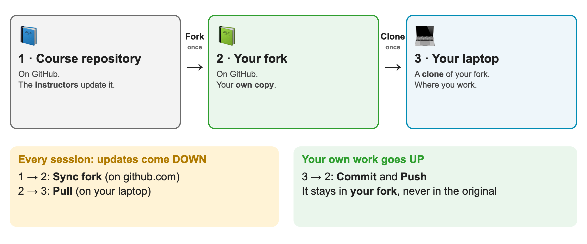
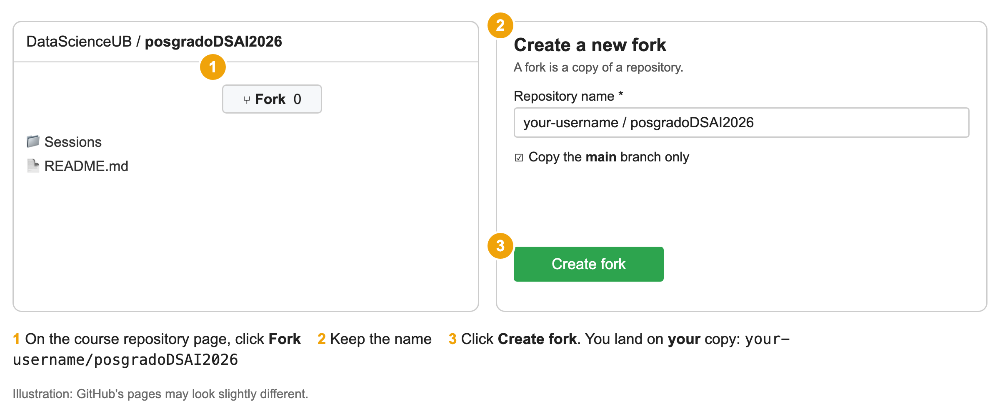
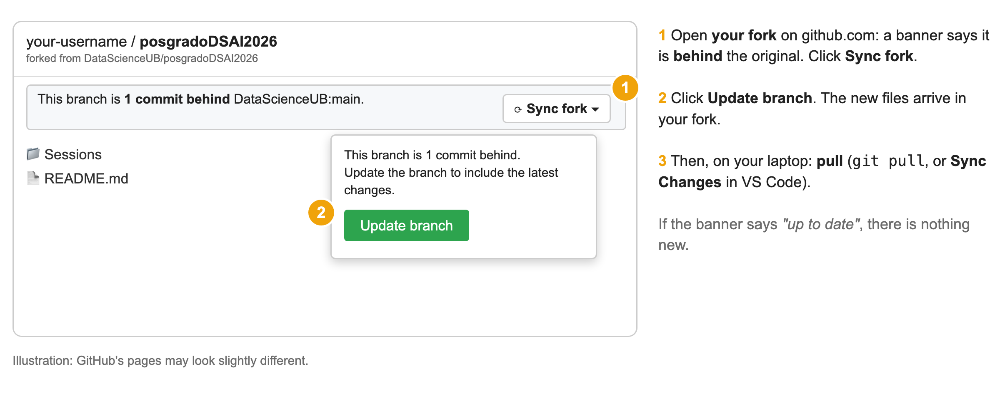

# Part 5 · Fork the course repository and keep it in sync

[← Back to the guide](README.md) · Previous: [4 · Your first repository (optional)](04_git_exercise.md)

**Exercise** (about 15 minutes). Do it **before the class** if you can; if you do not, we will do it together **in Session 02**. It is also the way you will get the **new course material** during the whole course.

## The idea, without jargon

Think of the course repository as a **master copy of the course notes**, kept on GitHub, that the instructors **update from time to time**.

* A **fork** is **your own photocopy** of it, also on GitHub. You can write on it as much as you want: **the master copy never changes because of you**.
* **Sync fork** is how you ask GitHub: *"bring the new pages of the master copy into my photocopy"*.
* Your **laptop** has a **clone** of your fork, a third copy where you actually work. **Pull** brings the new pages from your fork to the laptop.

*Updates come **down** (1 → 2 → 3). Your own work goes **up** only as far as **your fork** (3 → 2).*

**You do these only once:** *Fork* and *Clone*.
**You repeat these before every session:** *Sync fork* (on github.com) and *Pull* (on your laptop).

> Your own work (commit + push) goes to your fork. It never goes to the course repository, so you cannot break anything for anyone.

---

## Step 1 · Fork (once)
1. Sign in to <https://github.com> and open the course repository: <https://github.com/DataScienceUB/posgradoDSAI2026>.
2. Click **Fork** (top right) → keep the name → **Create fork**.
3. You are now on **your** copy: `your-username/posgradoDSAI2026`.

*(1) **Fork**, (2) keep the name, (3) **Create fork**. (Illustration: GitHub's pages may look slightly different.)*

Official help: [Fork a repository](https://docs.github.com/en/pull-requests/collaborating-with-pull-requests/working-with-forks/fork-a-repo).

## Step 2 · Clone your fork (once)
Copy **your fork** (not the course repository) to your laptop, **in its own folder**, for example `postgrau/`.
* **GitHub Desktop:** *File → Clone repository…* → tab *GitHub.com* → `your-username/posgradoDSAI2026` → choose the folder → *Clone*.
* **VS Code:** `Ctrl/Cmd + Shift + P` → *Git: Clone* → *Clone from GitHub* → choose your fork. (See [Part 4](04_git_exercise.md) for screenshots.)

You now have `postgrau/posgradoDSAI2026/` on your laptop, with the course material.

## Step 3 · Get new material (before every session)
1. **On github.com**, open **your fork**. If the instructors have added something, a banner says your fork is **behind**. Click **Sync fork → Update branch**.

*(1) **Sync fork**, (2) **Update branch**. (Illustration: GitHub's pages may look slightly different.)*

2. **On your laptop**, **pull** the update:
   * **GitHub Desktop:** *Fetch origin* → *Pull origin*.
   * **VS Code:** *Source Control* → **Sync Changes** (the same button you used to push).
   * **Terminal:** `git pull` inside the folder.

If the banner says your fork is **up to date**, there is nothing new.
Official help: [Syncing a fork](https://docs.github.com/en/pull-requests/collaborating-with-pull-requests/working-with-forks/syncing-a-fork).

## An example, step by step
In class we will add a **test file** to the course repository and you will bring it to your laptop:

| # | Who | What happens |
|---|---|---|
| 1 | Instructor | Adds a new file (for example `Sessions/Session_02/sync_test.md`) to the **course repository** |
| 2 | You | Open **your fork** on github.com: the banner says it is **1 commit behind** |
| 3 | You | **Sync fork → Update branch**. The file is now in your fork |
| 4 | You | On your laptop, **pull**. The file appears in your folder ✅ |

If you can open `sync_test.md` in your folder, **you know how to get every new resource of the course**.

## Where do I put my own work?
Two choices (both fine):
* **Simplest:** keep your work in **another folder, with your own repository** (Part 4 of this guide), and only use the fork to **receive** material. Copy there what you need.
* **In the fork:** create your own folder inside your fork (for example `my-work/`) and work there. Commit and push as usual: it goes to your fork. Avoid editing the instructors' files, so that *Sync fork* never finds a conflict.

> If *Sync fork* says there is a **conflict**, you edited a file that the instructors also changed. Stop and ask: it needs a decision.

---
[← Back to the guide](README.md) · Previous: [4 · Your first repository (optional)](04_git_exercise.md)
