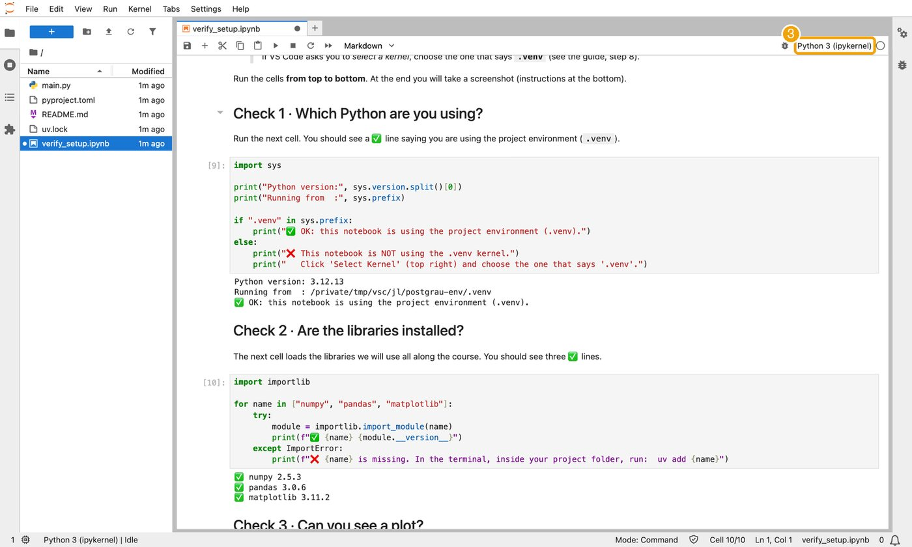

# Troubleshooting

[← Back to the guide](README.md)

| Problem | What to do |
|---|---|
| `uv: command not found` / *"uv is not recognized"* | Close **all** terminal windows and open a new one. On Windows, if it still fails, restart the computer. |
| Windows says *"running scripts is disabled"* | Use exactly the command of [2.2](02_installation.md#22-uv) (it contains `-ExecutionPolicy ByPass`) and run it in **PowerShell**, not in *cmd*. |
| `git: command not found` | Close and reopen the terminal. If it persists, reinstall Git ([2.3](02_installation.md#23-git)) with the default options. |
| The kernel list does not show `.venv` | Check that you opened the **`postgrau-env` folder** (File → Open Folder), not just the file. Then *Reload Window* (`Ctrl/Cmd + Shift + P`). |
| ❌ in Check 1 | You are using the wrong kernel: *Select Kernel* → `.venv`. |
| `ModuleNotFoundError` / ❌ in Check 2 | In the terminal, inside `postgrau-env`, run `uv add pandas matplotlib`; then in the notebook **Restart** the kernel and *Run All*. |
| VS Code asks to install "ipykernel" | Click *Install*, or run `uv add --dev ipykernel` in the terminal. |
| The kernel still does not work in VS Code | Use [**Plan B: JupyterLab**](#plan-b-jupyterlab-in-your-browser) below. |
| First commit fails: *"configure your user.name and user.email"* | Run the two `git config` commands of [2.3](02_installation.md#23-git). |
| GitHub says "repository not found" for the course repository | The repository is public at the beginning; once access is restricted, check that you are signed in with the account that belongs to the student group ([1.3](01_accounts.md#13-access-to-the-course-repository)). |
| Anything else | Take a screenshot of the error and bring it to the class. |

## Plan B: JupyterLab in your browser
If VS Code cannot find the kernel, JupyterLab runs the same notebook **in your browser**, with the same environment. In the terminal, inside `postgrau-env`:

```bash
uv add --dev jupyterlab
uv run jupyter lab
```

A browser tab opens with your files. Open `verify_setup.ipynb`, then use the menu **Run → Run All Cells**. Stop JupyterLab with `Ctrl + C` in the terminal when you finish. ([JupyterLab docs](https://jupyterlab.readthedocs.io/))


*(1) *Run* menu, (2) *Run All Cells*.*


*The same ✅ lines appear. (3) The kernel name must be *Python 3 (ipykernel)*.*

---
[← Back to the guide](README.md)
